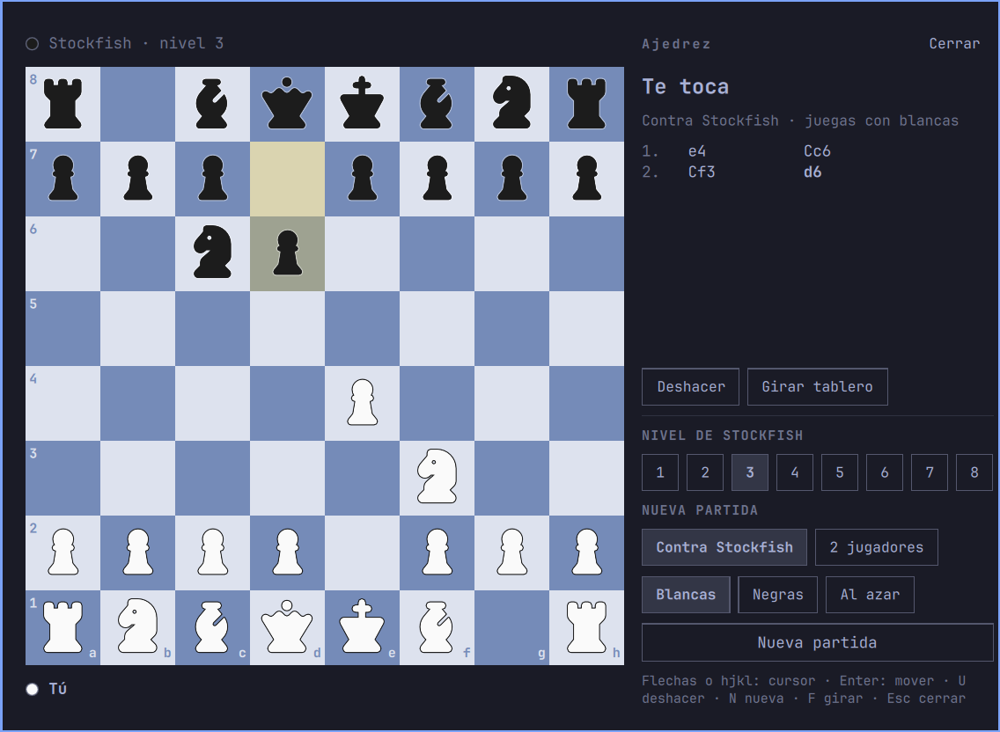

# Ajedrez (raul.chess)

Chess for the Omarchy shell: a board in a centered overlay, played against
Stockfish or by two people at one keyboard. A knight in the bar opens it.



## Install

```bash
yay -S stockfish   # the engine; two-player games work without it
omarchy plugin add https://github.com/vaccaroraul-afk/omarchy-chess.git --enable
```

The UI is in Spanish, and moves are written with Spanish piece letters
(R D T A C).

## How it works

- Rules: [chess.js](https://github.com/jhlywa/chess.js) 0.13.4, vendored
  unmodified as `chess.mjs` (BSD-2-Clause, see `LICENSE.chess.js`). Later
  releases use BigInt and class fields, which the Qt JS engine rejects.
- Engine: `stockfish` on `PATH` (`yay -S stockfish`), spoken to over UCI.
  It only runs while the board is open and a game against it is going.
- The game survives closing the board (the plugin is `keepLoaded`) and is
  saved to `~/.local/state/omarchy/chess.json` after every change.

## Files

| File              | Role                                                   |
|-------------------|--------------------------------------------------------|
| `Panel.qml`       | Overlay, game state, input, persistence                |
| `Board.qml`       | 8×8 view; no rules, no `qs.*` imports                  |
| `Engine.qml`      | Stockfish process and UCI handshake                    |
| `PlayerStrip.qml` | Name, captures and material lead above / below board   |
| `BarWidget.qml`   | Bar icon that toggles the panel                        |
| `Model.js`        | Pure helpers: squares, levels, UCI, status text        |
| `tests/ModelTest.qml` | Headless checks for `Model.js` and chess.js (perft) |

## Development

Saving a file hot-reloads the plugin, but the shell keeps the old compiled
QML, so run `omarchy restart shell` after a change. The tests need no shell:

```bash
QT_QPA_PLATFORM=offscreen /usr/lib/qt6/bin/qml tests/ModelTest.qml
```

## Controls

Click a piece then a square, or drag it. Keys: arrows or `hjkl` move the
cursor, `Enter`/`Space` pick up and drop, `u` undo, `n` new game, `f` flip,
`Esc` drops the selection and then closes. On promotion press `q r b n`
(or `d t a c`, or `1`–`4`).

Open it from anywhere with:

```bash
omarchy-shell shell toggle raul.chess
```

## Levels

| Level | Skill Level | Depth cap | Time per move |
|-------|-------------|-----------|---------------|
| 1     | 0           | 1         | 200 ms        |
| 2     | 2           | 2         | 300 ms        |
| 3     | 4           | 4         | 400 ms        |
| 4     | 7           | 6         | 500 ms        |
| 5     | 10          | —         | 400 ms        |
| 6     | 13          | —         | 600 ms        |
| 7     | 16          | —         | 900 ms        |
| 8     | 20          | —         | 1500 ms       |

## License

MIT, see `LICENSE`. The vendored chess.js keeps its own BSD-2-Clause
license in `LICENSE.chess.js`.
